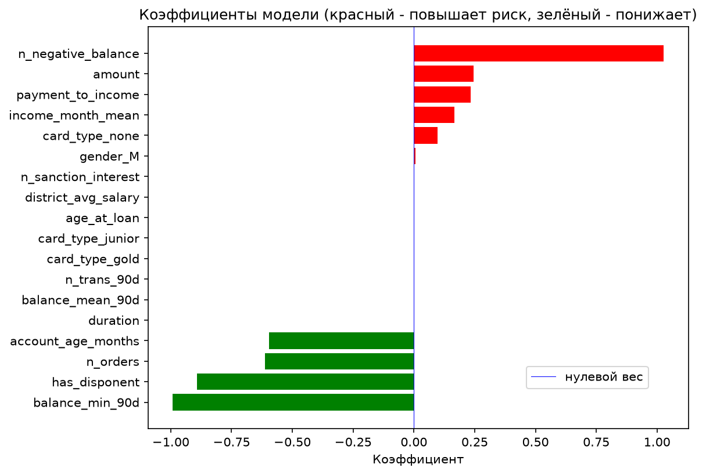

# Czech Bank Scoring
### Выполнил: Петрович Андрей Дмитриевич, НИУ ВШЭ ОП "Экономика и анализ данных"
---

Модель кредитного скоринга на реальных обезличенных данных чешского банка Berka: по истории счёта и данным о клиенте **на момент выдачи кредита** оценивает вероятность того, что кредит не будет возвращён.

## Задача

Банк выдаёт кредиты клиентам, у которых уже есть в нём счёт, и часть кредитов не возвращается. Можно ли заранее, в момент выдачи, предсказать, что кредит станет проблемным?

Ответ даёт бизнесу:
- правило одобрения - кому выдавать кредит, а кому нет, в зависимости от отпределенных характеристик;
- возможность снизить издержки, связанные с рисками;
- список понятных признаков риска, которые могут быть переданы аналитикам.

**Почему логистическая регрессия:** она даёт вероятность дефолта, а не только «да / нет»; у каждого признака есть интерпретируемый коэффициент; модель устойчива на маленькой выборке, где сложные модели (e.g. Random Forest) переобучаются.

## Данные

[The Berka Dataset (Kaggle)](https://www.kaggle.com/datasets/marceloventura/the-berka-dataset) — 8 связанных таблиц, 1993–1998 годы.

| Таблица | Строк | Содержимое |
|---|---:|---|
| `account` | 4 500 | счета: район, частота выписок, дата открытия |
| `client` | 5 369 | клиенты: зашифрованные дата рождения и пол, район |
| `disp` | 5 369 | связь клиент — счёт и роль (владелец / распорядитель) |
| `trans` | 1 056 320 | операции: дата, тип, сумма, остаток после операции |
| `loan` | 682 | кредиты: дата, сумма, срок, платёж, статус |
| `card` | 892 | карты: тип, дата выдачи |
| `order` | 6 471 | автоплатежи |
| `district` | 77 | районы: население, безработица, зарплата, преступность |

**Целевая переменная:** кредит плохой (`bad_loan = 1`), если он закрыт и не выплачен (статус B) или действует с долгом (статус D). Плохих кредитов **76 из 682 (11%)** — классы несбалансированы.

## Этапы

1. **Загрузка** (`sql/01_schema.sql`, `src/load_data.py`) — 8 таблиц в схеме `raw` (необработанные данные), загрузка через `COPY`.
2. **Проверки целостности** (`sql/02_checks.sql`) — число строк, уникальность ключей, не больше одного кредита на счёт. Проблем не было найдено.
3. **Очистка** (`sql/03_clean.sql`) — представления в схеме `clean` (обработанные): даты `YYMMDD` → `DATE`, пол и дата рождения из `birth_number`, расшифровка чешских кодов операций, пропуски `?` → `NULL`.
4. **Целевая переменная** (`sql/04_target.sql`) — `bad_loan` и доля плохих кредитов в разрезах (срок, год, район).
5. **Витрина признаков** (`sql/05_features.sql`) — одна строка на кредит, 16 признаков: остаток на счёте за 90 дней, число уходов в минус, штрафные проценты, доход и долговая нагрузка (платёж / доход), возраст клиента и счёта, второй распорядитель, карта, автоплатежи, зарплата в районе.
6. **Модель** (`notebooks/01_model.ipynb`) — логистическая регрессия, параметры регуляризации подобраны с помощью `GridSearchCV` и кросс-валидации.
7. **Визуализация** (`notebooks/02_visualization.ipynb`).

## Защита от утечки данных

Все признаки считаются только по информации, доступной **до даты выдачи кредита**:
- операции — строго `trans_date < loan_date`;
- карты — только выданные до кредита (134 из 170 заёмщиков получили карту уже после);
- автоплатежи — без платежа по самому кредиту (он есть у всех 682 заёмщиков и выдал бы наличие кредита).

## Результаты

Лучшая модель — L1-регуляризация, `C = 0.1`.

| Метрика | Значение |
|---|---:|
| ROC-AUC, кросс-валидация | **0.91 ± 0.03** |
| ROC-AUC, тестовая выборка | **0.83** |
| Recall , тестовая выборка | 0.64 |
| Precision, тестовая выборка | 0.35 |

Модель настроена в первую очередь не пропускать плохие кредиты ценой лишних отказов: для банка выданный плохой кредит обходится дороже, чем отказ хорошему клиенту.

## Что влияет на риск



- **Повышают риск:** уход остатка в минус до кредита — самый сильный признак; крупная сумма кредита; высокая долговая нагрузка.
- **Понижают риск:** высокий минимальный остаток на счёте за 90 дней; второй распорядитель счёта; автоплатежи; более долгая история счёта.
- **Не влияют:** L1-регуляризация обнулила срок кредита, возраст клиента, зарплату в районе и ряд других признаков.

Самый наглядный факт: **у всех 27 заёмщиков, чей остаток уходил в минус до кредита, кредит оказался плохим**, а среди остальных плохих только 7%.


## Ограничения

- **Маленькая выборка** — 682 кредита и 76 плохих; в тестовой выборке всего 11 плохих кредитов, поэтому метрики на тесте шумные.
- **Незрелые кредиты** — данные заканчиваются в 1998 году, и часть действующих кредитов (статус C) ещё может стать плохой; у кредитов 1998 года доля плохих всего 2.5%.
- **Старые данные одной страны** — выводы иллюстративны, а не универсальны.

## Структура репозитория

```
├── sql/
│   ├── 01_schema.sql            # сырые таблицы
│   ├── 02_checks.sql            # проверки целостности
│   ├── 03_clean.sql             # очистка
│   ├── 04_target.sql            # целевая переменная
│   └── 05_features.sql          # витрина признаков
├── src/
│   ├── db.py                    # подключение к PostgreSQL
│   ├── load_data.py             # загрузка CSV
│   └── run_sql.py               # пересборка базы и выгрузка витрины
├── notebooks/
│   ├── 01_model.ipynb           # модель и метрики
│   └── 02_visualization.ipynb   # графики
├── reports/figures/             # графики
├── .env.example                 # образец параметров подключения
└── requirements.txt
```

## Как запустить

1. Установить PostgreSQL и создать пустую базу.
2. Создать окружение и установить библиотеки:
   ```bash
   conda create -n berka python=3.12
   conda activate berka
   pip install -r requirements.txt
   ```
3. Скопировать `.env.example` в `.env` и указать параметры своей базы.
4. Скачать CSV с [Kaggle](https://www.kaggle.com/datasets/marceloventura/the-berka-dataset) в `data/raw/`.
5. Собрать базу и витрину признаков (около 5 секунд):
   ```bash
   python -m src.run_sql
   ```
6. Запустить по порядку `notebooks/01_model.ipynb` и `notebooks/02_visualization.ipynb`.
